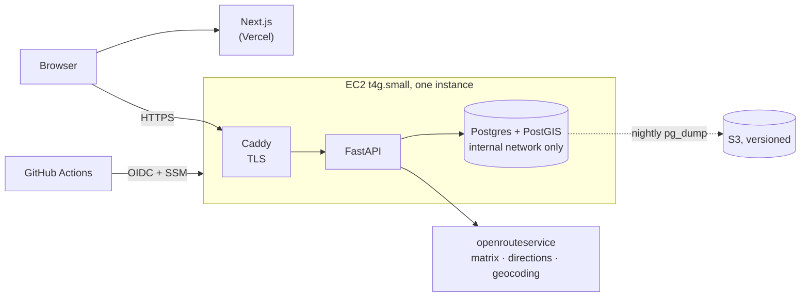

# CarpoolOptimizer

An organizer enters who is coming, who is driving and how many seats each car has. The system
decides who rides with whom and in what pickup order, for the trip there and the trip home.

**Live:** [whodriveswho.com](https://www.whodriveswho.com) · **Example result, no sign-up:**
[whodriveswho.com/demo](https://www.whodriveswho.com/demo)

Built first for a campus club's weekly practices: 20–60 people, a fixed venue, the same roster
every week.

## Why it is harder than it looks

Every car starts at its driver's home and ends at the same venue, so this is a capacitated pickup
problem, a variant of Dial-a-Ride. It is NP-hard, but that shared endpoint splits it in two
([`docs/design.md`](docs/design.md) §8.2):

- **Sequencing is exact.** Once a car's riders are chosen, the best pickup order is a shortest
  Hamiltonian path over at most 8 stops. Held–Karp solves that exactly in microseconds. No solver
  here can return a badly ordered car.
- **Assignment is the hard part.** Who rides with whom is where the heuristics compete. When there
  are fewer seats than riders, choosing *who is left out* is most of the cost.
- **The return trip is sequenced separately.** Reversing the outbound order would be exactly
  optimal on a symmetric map. Real road times are not symmetric (one-way streets, divided roads), so
  each leg gets its own order.

The objective weighs total driving, riders' time in the car, driver detour, unseated riders (scaled
by a per-person priority) and, when re-solving, how many people change cars
([`docs/design.md`](docs/design.md) §8.1).

## How good the answers are

Production runs a greedy construction, then a large neighbourhood search (LNS: ruin-and-recreate
under simulated annealing) on a one-second budget. To measure it, a benchmark-only exact model on
OR-Tools CP-SAT proves the true optimum. It proved every benchmark instance up to n = 50 optimal,
which is the per-event cap.

Gap above the proven optimum (mean / worst over 9 instances per row):

| participants | seats vs. riders | greedy | LNS (1 s) | LNS found the optimum |
|---|---|---|---|---|
| 20 | enough for everyone | 0.7–6.9% / ≤ 27% | **0.00% / 0.00%** | 18/18 |
| 20 | about a quarter short | 11.5% / 21% | **0.57% / 4.5%** | 7/9 |
| 50 | enough for everyone | 2.1–7.5% / ≤ 22% | **0.32–0.34% / ≤ 2.0%** | 8/18 |
| 50 | about a quarter short | 20.4% / 44% | **5.1% / 9.1%** | 1/9 |

Full tables, including sizes up to 1,000 and the spatial distributions, are in
[`docs/benchmarks/`](docs/benchmarks/). They are generated from committed JSON (`make bench`), and a
test fails if the tables go stale. A smaller version runs in CI as a quality gate, so a refactor
that keeps every answer feasible but makes them worse still fails the build.

**Every benchmark instance is synthetic** (generated uniform, clustered and radial layouts, on
straight-line travel times). These are measurements of the solver, not of real events.

## What the app does

- Roster entry one person at a time or pasted in bulk, with address autocomplete proxied through
  the API so the provider key never reaches the browser.
- Solving on [openrouteservice](https://openrouteservice.org) road times. If the provider fails,
  the solve falls back to straight-line estimates and the results screen says so. An address no
  road reaches leaves out only that person, by name.
- A results dashboard: each car's route drawn along the roads on a map, pickup and drop-off order
  for both legs, and an "Open in Google Maps" link per car per leg.
- Pins: the organizer can put a rider in a particular car and re-solve around it. Re-solves keep
  everyone else in their previous car where they can.

## Architecture



- **`packages/domain` performs no I/O.** It takes a `ProblemInstance` and returns a `Solution`, so
  the API and the benchmark harness run the same solver, and solver tests need no infrastructure
  (§4.1).
- **The API contract is asynchronous; today the executor runs inside the request.** `POST` returns
  a job id and the client polls it. The solve runs in a thread, at most two at a time. A partial
  unique index allows one in-flight job per event. An `Idempotency-Key` makes retries safe, and an
  input fingerprint returns an identical problem's earlier answer without solving it again. With a
  one-second budget, a separate worker process is not yet justified; §4.2 lists what would justify
  it.
- **No long-lived AWS credential exists.** The developer uses SSO and CI uses OIDC. The deploy role
  can send only one SSM document, which deploys an image by digest. The instance writes backups
  through its IAM role. There is no SSH port, and only 80/443 are open (§10.1).
- **Infrastructure is Terraform** (`infra/`): VPC, instance, IAM, backup bucket, CloudWatch alarms.
  Nightly backups go to S3, and a restore has been rehearsed.

## Real use vs. synthetic numbers

The benchmark numbers above are synthetic. No real-event figures are reported here yet; when they
are, they will be stated separately from the benchmarks.

## Development

```sh
make setup     # venv, hashed dependency locks, web packages, git hooks
make db        # Postgres + PostGIS in Docker, bound to 127.0.0.1
make check     # ruff, mypy (strict), pytest, then the web checks — what CI runs
make api       # FastAPI on :8000
make web       # Next.js on :3000
make bench     # the benchmark grid (~30 min), then `make bench-report`
```

Copy `.env.example` to `.env` first. Without an `ORS_API_KEY` the API solves on straight-line
estimates.

```
packages/domain/   the solver: models, objective, greedy, LNS, Held–Karp, validation — no I/O
packages/bench/    benchmark harness and the exact CP-SAT model (never in the production image)
apps/api/          FastAPI service, schema and migrations, the database ↔ domain adapter
apps/web/          Next.js frontend (App Router, TypeScript strict)
infra/             Terraform
deploy/            production compose file, Caddyfile, backup and restore scripts
docs/              design document, benchmarks, roadmap
```

Design decisions and the reasons for them are in [`docs/design.md`](docs/design.md).
